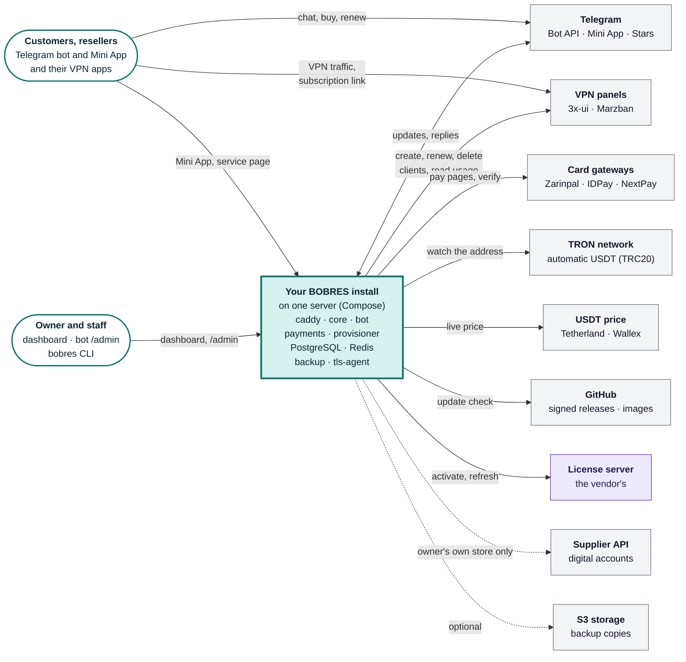
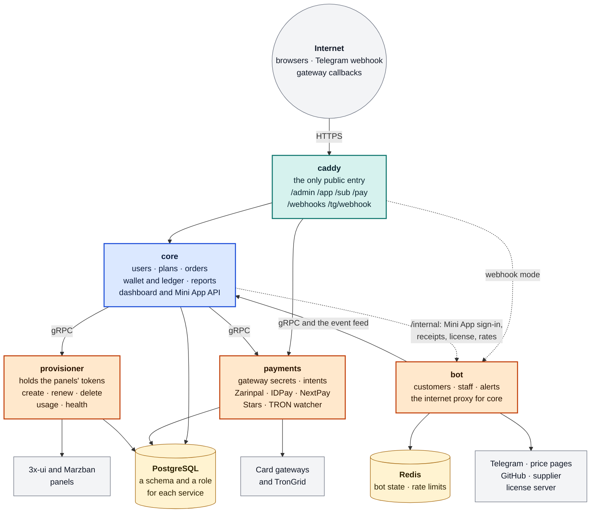
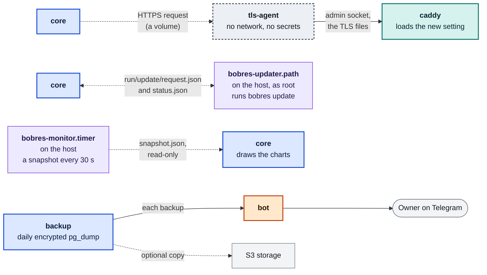
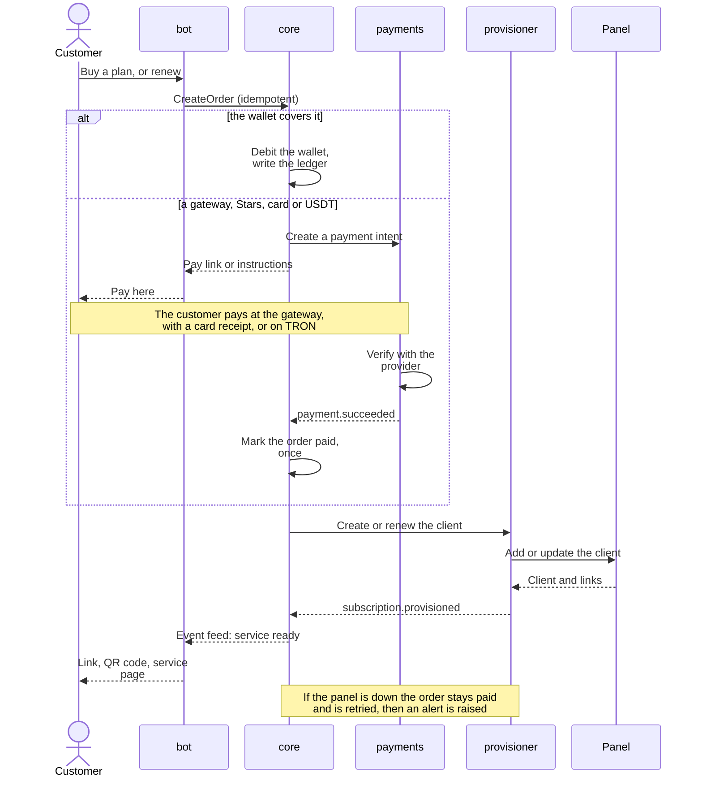
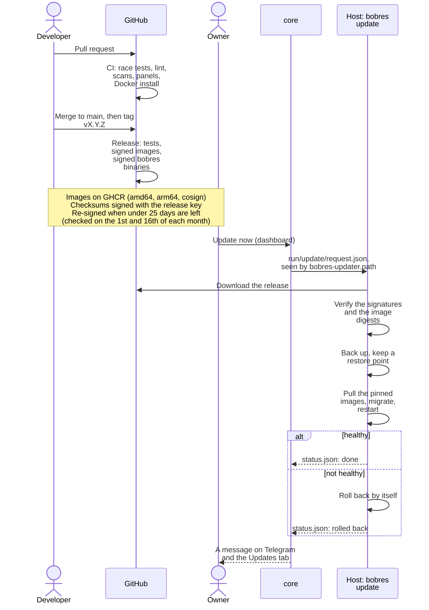
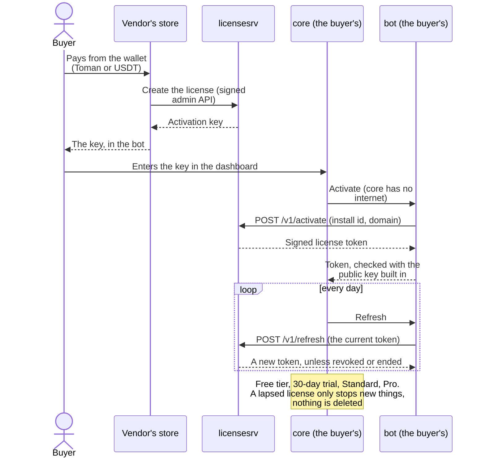

# BOBRES 3x-ui Telegram Panel

**Launch your own VPN store on Telegram in one command.**

BOBRES sells and manages VPN subscriptions on [3x-ui](https://github.com/MHSanaei/3x-ui) (Xray) panels, and on Marzban. Your
customers buy, pay, renew and get support in a **Telegram bot** or its **Mini App**; you run the store from a **web
dashboard**; and one **`bobres` command** on the server installs, updates, backs up and repairs everything.

It is white-label and single-tenant: each operator runs it on their own server, with their own domain, bot, panels and
brand. Nothing goes through anyone else's servers.

Website: <https://bobresai.cv> · Latest release: **v0.17.1** · [Changelog](CHANGELOG.md) · [Docs](docs/README.md)

## At a glance

| | |
|---|---|
| **Customers** | A Persian and English Telegram bot and Mini App: plans (in groups with a text each), wallet, free trial, renewals, traffic packages, bulk purchase, gift and reward codes, invite links, support, a page for every service |
| **Resellers** | A panel in the bot and the Mini App: buy for customers at tier prices on credit, manage their services, commission; their configs carry their own prefix and group in your 3x-ui panel |
| **You** | A dashboard for plans, payments, orders, users, resellers, reports, branding, panels, gateways, staff, backups, updates and licenses; Telegram alerts; `/admin` in the bot |
| **Payments** | Wallet, card to card, USDT (manual and automatic on TRON), Zarinpal, IDPay, NextPay, Telegram Stars |
| **Panels** | 3x-ui v3.8.5 to v3.10.2 and Marzban 0.8, several at once, each tested against the real panel in CI |
| **Server** | `bobres`: install, status, logs, update with automatic rollback, encrypted backups and restore, HTTPS, hardening, health checks |
| **Pricing** | Free core, paid premium: a free tier, a 30-day trial of everything, then a license per install ([docs/pricing.md](docs/pricing.md)) |

## Status

Phases 0 to 7 of the plan are built and tested in CI ([docs/PLAN.md](docs/PLAN.md) §10, [CHANGELOG.md](CHANGELOG.md)).
The first public release, v0.1.0, came out on 2026-10-14; releases since then are signed, built for amd64 and arm64, and
verified by the installer and by `bobres update`. They were tried in a Docker lab with two Ubuntu servers
([docs/11-staging-run.md](docs/11-staging-run.md)), and the vendor runs its own store on them.

Still open: the legal review, the brand checks (domain, bot name, trademark), and two checks only the real world can give:
the import links on the subscription page have not been tried on real devices, and the Mini App is not yet checked
against every Telegram client. Two parts were set aside on purpose: third-party crypto processors (they exclude Iran) and
adapters for older 3x-ui versions (built only when a customer needs one). What is left before selling widely is in
[docs/launch-checklist.md](docs/launch-checklist.md).

## Install

You need:

- A server with **Ubuntu 22.04/24.04 or Debian 11/12/13** (amd64 or arm64), 1 GB of RAM (2 GB recommended), 10 GB of free
  disk, ports **80 and 443** free, and root access.
- A **domain** whose A record points to the server.
- A new **Telegram bot** from [@BotFather](https://t.me/BotFather), and your numeric **Telegram ID** (the owner).
- A **3x-ui panel** (v3.8.5 to v3.10.2 are tested) with an API token. You can also add panels, 3x-ui or Marzban, later in
  the dashboard.

As root on the server:

```bash
bash <(curl -fsSL https://raw.githubusercontent.com/sobhanaz/bobres-3x-ui-telegram-panel/main/install/install.sh)
```

What it does:

1. Installs Docker if needed, downloads the `bobres` command from the latest GitHub release and **verifies its signature
   and checksum** (Ed25519) before running anything.
2. Asks only what has no safe default: your domain, your Telegram ID, the bot token and the first 3x-ui panel with its API
   token. Tokens are typed hidden, and the panel's token is **checked against the real panel before anything is written**.
3. Starts the stack (Caddy for HTTPS, PostgreSQL, Redis and the BOBRES services) and waits until it is healthy.
4. Hardens the server where that is safe (firewall, fail2ban, automatic security updates, swap).
5. Ends with a **"BOBRES is ready"** card: your dashboard address, the bot, and your **backup key** (save it: backups are
   encrypted with it).

It shows the BOBRES banner and one progress bar from 0 to 100%, keeps going if your SSH connection drops (follow it with
`tail -f /var/log/bobres-install.log`), and prints plain lines when the output is a pipe or a log. Flags (a panel on the
same server, S3 copies of the backups, Zarinpal, a different SSH port, hardening choices...): `bobres install -h` and
[docs/06-installer.md](docs/06-installer.md).

**First steps after the install**

1. Open your bot in Telegram and send `/start`; as the owner you get an **Admin** and a **Dashboard** button. `/dashboard`
   (or `sudo bobres admin link`) gives a one-time login link to `https://<your domain>/admin`.
2. In the dashboard: **Servers** (your panels), **Plans** (what you sell and its price), **Gateways** (how customers
   pay), **Branding** (your name, logo and every bot text), **Settings**.
3. Run `sudo bobres check` to see every part of the install in PASS/WARN/FAIL lines.

## The `bobres` command

Run `sudo bobres` for the management menu, or use any item as a command. The header is a live status board (services, license, HTTPS certificate, newest backup, dashboard address); the numbers below are the menu's choices:

```text
   n____n   BOBRES manager  bobres v0.17.1
  ( o  o )  /opt/bobres  ·  shop.example.com  ·  version 0.17.1
   \_||_/   Store     running (9/9 services)
            License   Standard license, 214 days left
            HTTPS     auto, certificate expires in 79 days
            Backup    newest 6 hours ago (4.2 MB)
            Dashboard https://shop.example.com/admin   (bobres admin link: one-time login link)
  ──────────────────────────────────────────────────────────
   1. Status
   2. Live logs (Ctrl+C returns here)
   3. Start
   4. Stop
   5. Restart
  ──────────────────────────────────────────────────────────
   6. Show settings
   7. Change the bot token
   8. Owners (Telegram IDs of the store owners)
   9. Change the first 3x-ui panel (used until the dashboard has a server)
  ──────────────────────────────────────────────────────────
  10. Back up now
  11. Backup key
  12. Restore a backup
  ──────────────────────────────────────────────────────────
  13. Update BOBRES (check for a new release)
  14. Roll back the last update
  ──────────────────────────────────────────────────────────
  15. Dashboard login link (if the bot is down)
  16. Reset admin password (sign in without Telegram)
  17. Check this server
  18. Check everything (server, settings, services, bot, backups, license)
  ──────────────────────────────────────────────────────────
  19. HTTPS certificate
  ──────────────────────────────────────────────────────────
  20. Uninstall
  ──────────────────────────────────────────────────────────
  21. About BOBRES (version, license, links)
   0. Exit
```

| Command | What it does |
|---|---|
| `bobres status` | Services, version and disk; exit code 1 when something is down; `--json` for scripts |
| `bobres logs [-f] [--tail N] [service...]` | Service logs |
| `bobres start` / `stop` / `restart` | Start, stop (nothing is deleted) or restart the store and wait until it is healthy |
| `bobres update [--check]` | Update to the latest release: signature check, backup first, **automatic rollback** if the new version does not come up healthy. Also in the dashboard (System > Updates > Update now) |
| `bobres rollback` | Undo the last update: the previous version and the database from before it |
| `bobres backup` / `restore <file>` | Encrypted backup now (kept in `/opt/bobres/backups`, sent to the owner on Telegram, optionally copied to S3-compatible storage) / replace the data with a backup |
| `bobres admin link` / `admin password` / `admin owners` | A one-time dashboard login link / reset the owner's dashboard password (no Telegram needed) / list, add or remove the store's owners (Telegram IDs) |
| `bobres config list \| get \| set` | Show or change a setting |
| `bobres ssl status \| auto \| ip \| manual` | The HTTPS certificate: Caddy's automatic one, a Let's Encrypt one for the server's IP, or your own |
| `bobres secrets rotate bot-token \| db-passwords \| service-tokens \| redis-password` | Rotate a secret |
| `bobres license status \| import \| activate` | Show the license, install a token, or activate a license key with the vendor's license server |
| `bobres harden` | Firewall (ufw), fail2ban, automatic security updates and swap, each asked first |
| `bobres monitor status \| enable \| disable` | Host monitoring for the dashboard's charts |
| `bobres doctor` / `bobres check` | Check this server (RAM, disk, ports, Docker, DNS, HTTPS, hardening) / check the whole install; `--json` |
| `bobres support-bundle` | A redacted archive for support (versions, status, logs; no secrets) |
| `bobres version [--images]` / `about` | The version and the image digests it pins / version, license and links |
| `bobres uninstall` | See below |

Every command takes `--plain` (no colors or redrawing) and `--no-banner`; commands that work on an install take `--dir`
(default `/opt/bobres`). Runbooks for what to do when something goes wrong: [docs/runbooks](docs/runbooks/README.md).

### Updating

Releases are signed (Ed25519) and their images are signed with cosign. `sudo bobres update` (or **Update now** in the
dashboard, for the owner) checks the signature, backs up, pulls the pinned images, restarts, waits for health and **rolls
back by itself** if the new version does not come up healthy. `sudo bobres update --check` only looks. Core and the bot
always move together; a database migration is run by the update and is additive, so a rollback keeps your orders and
credit. The stable channel is the default; `updates.channel` can be set to beta for pre-releases.

### Uninstall

| Command | What it does |
|---|---|
| `sudo bobres uninstall` | Stops and removes the containers; the data, the certificates and `/opt/bobres` stay (`bobres start` brings the store back) |
| `sudo bobres uninstall --purge --dry-run` | Prints exactly what would be removed, with sizes, and changes nothing |
| `sudo bobres uninstall --purge` | **Day one:** removes everything BOBRES put on the server (data, secrets, backups, containers, volumes, images, systemd units, firewall rules, the files the hardening wrote, the `bobres` command), so that the server is as it was. Asks for a verified final backup, then for the domain typed in full |
| `sudo bobres uninstall --purge --backup-to FILE` | The same, with a final backup written outside the install directory and read back before anything is deleted |
| `sudo bobres uninstall --purge --remove-docker --remove-packages` | Also removes Docker and the packages BOBRES installed, when nothing else uses them |
| `sudo bobres uninstall --verify` | Scans the server for what is left of BOBRES |

It touches only what it can prove is BOBRES's, never SSH settings or the SSH firewall rule, and can be run again after an
interruption. What installing BOBRES changes on a server, flag by flag, and how to restore the final backup on a new
server: [docs/06-installer.md](docs/06-installer.md) and [docs/runbooks/uninstall.md](docs/runbooks/uninstall.md).

## Features

**Telegram bot, for customers** (Persian and English, in your own name, texts and links)
- **Buy a plan** (traffic-limited, time-only or both), with an optional discount code. The service arrives with its
  subscription link and a QR code. A bottom menu keeps the main buttons one tap away.
- **Plan groups:** put plans in named groups with a text for each (what the group is for, who it suits). The customer picks
  a group, reads its text, then picks a plan of it; plans with no group are under "Other plans"; with no group at all,
  plans are listed as before.
- **My services:** status, expiry and traffic used; renew, or add a traffic package, with the same link. A service that is
  not in the list is **found by its subscription link** (its state, and Renew, paid by the customer who holds the link).
- A **wallet** with top-ups and history, **gift codes** that add credit, **reward codes** (mark a plan, say the unlimited
  one: each paid purchase gives the buyer a discount code, a percent or a fixed amount, for any plan they buy next, for
  them only, one use, for the days you set, with your own text), **one free trial** per Telegram account, **bulk purchase**, and invite links that reward the inviter on a
  friend's first paid purchase, with a Top users board. Three growth tools are off until you switch them on: **cashback**
  (a share of each delivered order goes back to the buyer's wallet, and comes back out of a refund), a **daily wheel of
  fortune** (one free spin a day for customers with paid orders, drawn on the server, paid out of a daily budget you set)
  and **monthly targets** (resellers who sell enough new services in a month are paid a bonus, once per tier).
- **Reminders** 3 days and 1 day before expiry, at 80% of the traffic and at the end, with Renew and Add traffic buttons.
- **Support** conversations with text, photos and PDFs; staff replies arrive in the chat. A **help center** (FAQ and
  video tutorials) the owner edits in the dashboard.
- **Store rules:** maintenance mode, required channels and groups (one on the free tier, more with Pro), rate limits,
  terms and privacy links.
- A **page for each service** at `/sub/<token>`, under your brand: usage and days left, the subscription link and QR
  code, import buttons for v2rayNG, Hiddify, Streisand and V2Box, and a Renew button.
- A **Telegram Mini App store** at `/app/`, on for every store: plans in groups, buying, services, renewals, the wallet,
  the free trial, invites and support, paid with the wallet, a gateway, Telegram Stars, or card to card, USDT and a
  Zarinpal link with a receipt. It follows the store's rules as the bot does (bans, maintenance, the required channel).

**Resellers, in the bot and the Mini App**
- A reseller panel: buy for customers at the tier's prices, on credit up to a limit; name and find their services;
  a statement; an invite link that earns a commission on their customers' purchases.
- Manage their customers' services: pause and resume, delete (after a confirmation), a private note, the list in
  groups (active, ending soon, ended, paused) with counts, and the customers who joined through their link with what
  they bought. Nothing that gives free days or traffic.
- **In your 3x-ui panel** a reseller's configs are named with the reseller's own **prefix** (`sob-u123-...`, chosen once
  in the bot or the Mini App) and are in a group of their own, **`BOBRES-<NAME>`** (the name you give them), so it is
  clear which reseller made them. Every other client the bot makes is in the group `BOBRES`.

**Staff**
- In the bot: `/admin` (stats, find a user, adjust a balance, ban, the payments to review with their receipts), `/set`,
  plans, trials, traffic packages, discount codes, and `/dashboard` for a one-time dashboard login link.
- **Alerts in Telegram:** payments to review, new tickets, failed deliveries, sales (optional) and system problems.
- **Several owners** (root admins), named on the server with `bobres admin owners`: all of them get the alerts and the
  daily backup and see the same list of payments to review; the first decision on a payment counts.

**Web dashboard** at `https://<domain>/admin`
- Log in with a one-time link from the bot, or with a password and an authenticator code. Roles: owner, admin, support.
  Persian and English, dark and light.
- **Overview, users, services, support inbox, broadcasts; plans (and plan groups, rewards), payments with the receipt
  review queue, ledger with CSV export, reports, discounts, gift codes, resellers; branding and every bot text,
  settings, panel servers, payment gateways; staff, the System page (health, charts, updates, logs, backups, restore,
  HTTPS certificates, license) and the audit log.**
- **Reports:** revenue per currency by day, week or month (Gregorian or Jalali), orders, new customers, renewals, churn,
  top plans and which provider paid, with CSV files, a printable professional report and an optional daily summary in
  Telegram.

**Payments**
- The wallet; card to card, USDT (TRC20 or ERC20) and a Zarinpal payment link, each with a screenshot staff approve;
  Zarinpal online; Telegram Stars; **automatic USDT on TRON (TRC20)**, which matches an exact, unique amount on the chain;
  IDPay and NextPay, two more Iranian card gateways (off until credentials are set).
- Each payment settles exactly once. The ledger is append-only, and amounts are whole numbers in minor units.

**3x-ui and Marzban**
- Several panel servers, each 3x-ui (**v3.8.5 to v3.10.2**, every release in that range tested against the real panel in
  CI) or Marzban 0.8, with health checks, weights, servers per plan and inbound choices per server.
- Every client the bot makes is put in a 3x-ui **client group** (`BOBRES`, or `BOBRES-<NAME>` for a reseller), so you can
  filter on what the bot made in the panel; a group you set by hand is never touched.

**Operations**
- A one-command install on Ubuntu or Debian, and the `bobres` menu and commands on the server.
- Daily **encrypted backups**: the newest 7 kept on the server, each sent to the owner on Telegram, optional copies in
  S3-compatible storage; download and restore from the dashboard; `bobres restore` puts one back.
- **Updates** with stable and beta channels and an automatic rollback, from the command line or the dashboard.
- The whole store **comes back by itself after a reboot**: a systemd unit starts it at every boot, and a store you stopped on purpose
  (`sudo bobres stop`) stays stopped until you start it.
- **HTTPS** from the dashboard's HTTPS tab or `bobres ssl`: Caddy's automatic certificate for the domain (the default), a
  Let's Encrypt certificate for the server's IP address, or your own certificate and key. A change is saved only once
  Caddy accepts it, and `sudo bobres ssl auto` is the way back when a wrong certificate locks browsers out.
- System alerts in Telegram, host monitoring and charts, operator runbooks, a redacted support bundle, server hardening,
  `bobres config` and `bobres secrets rotate`.

**Free core, paid premium**
- No license is needed to run a store. An install without one has a free tier: 1 server, 25 active services, 2 staff
  seats, the Zarinpal, Stars and manual payment methods, and security updates always. Resellers, automatic USDT, more
  servers, services, staff and required channels, and removing "Powered by BOBRES" come with a license.
- Every install starts with a **30-day trial** that has everything but white label. When it ends, the limits stop only
  new servers, services, resellers, staff and payment methods: existing services keep working and renewing, and a
  customer never sees a word about licensing ([docs/05-license.md](docs/05-license.md), [docs/pricing.md](docs/pricing.md)).
- Licenses are signed tokens bound to your domain and install, activated with a license key
  (`bobres license activate`) and renewed online every day. Standard is 4 USDT a month and Pro 12 USDT a month (a year at
  ten months), paid in USDT on TRON.
- The vendor's own store features (selling licenses from the vendor's bot, reselling a supplier's digital accounts, a
  license manager) are locked behind an entitlement no tier has: they are hidden, refused and off in every customer's
  install.

**Security**
- Four services, each with its own database role and service token. Only the provisioner holds the panels' tokens, only
  payments holds the gateway secrets, and **core has no internet access** (what it needs from the internet goes through
  the bot's narrow internal endpoints).
- Secrets at rest are encrypted with a master key per service. Releases are signed (Ed25519); images are signed with
  cosign and run by the digests the signed CLI carries.
- A small `tls-agent` with no network is the only writer of Caddy's TLS files; an own certificate's private key is sealed
  with core's master key.
- The dashboard has CSRF protection, authenticator codes for every password login, a strict CSP and an append-only audit
  log. Details and the threat model: [docs/07-security.md](docs/07-security.md), [SECURITY.md](SECURITY.md).

## Architecture

BOBRES is a Go monorepo that runs as nine Docker Compose services on one server: Caddy, PostgreSQL, Redis, and the
BOBRES services. Four of them do the work (`core`, `bot`, `payments`, `provisioner`). Each has its own database role, its
own service token and its own network reach: **core has no internet access**, only the provisioner holds the panels'
tokens, and only payments holds the gateway secrets. The dashboard and the Mini App are Vue 3 apps built into the `core`
binary. The pictures below follow the compose files and the code; the details are in [docs/PLAN.md](docs/PLAN.md),
[docs/02-events-and-apis.md](docs/02-events-and-apis.md) and [docs/07-security.md](docs/07-security.md).

### The big picture



Solid arrows are calls the store always makes; dotted ones are optional or exist only on the vendor's own store. The
only vendor-run server a store talks to is the license server, and a store works without it on the free tier. Nothing
is relayed through the vendor: the store calls the services above directly.

### Inside one install



- **Teal** is the only public entry. **Orange** can reach the internet (`bot`, `payments`, `provisioner`). **Blue** has no
  route out (`core`).
- In Docker terms: `public` holds only Caddy; `edge`, `backend` and `offline` are internal networks; only `egress` has a
  route out. Caddy answers nothing under `/internal` and `/api/internal`, so service-to-service endpoints never reach the
  internet.
- **Calls** are gRPC on the internal networks, one token per service, and a server accepts only its legitimate callers
  (core accepts the bot; payments and provisioner accept only core). The contracts are in `proto/`.
- **Events** (`order.paid.v1`, `subscription.provisioned.v1`...) are past-tense facts written to a transactional outbox in
  the transaction that made them; consumers pull them with a cursor and de-duplicate with an inbox. A failure retries with
  back-off, then goes to a dead-letter table and raises an alert.
- **Money** is a whole number in minor units with a currency, never a float. The ledger is append-only, a wallet balance
  is a cached sum of it, and every money-moving call carries an idempotency key with a unique index.

### Housekeeping: HTTPS, updates, monitoring and backups



No container has the Docker socket. An update, a restore or an HTTPS change reaches the host as a small request file that
a root systemd unit or the `tls-agent` picks up, and the host's monitoring snapshot comes back the same way, read-only.
The `tls-agent` is core's image with no network; it checks a request again and answers `invalid` to any name that is not
the install's own.

### An order, from tap to config



A wallet payment skips the payment step. A gateway's callback is never trusted alone: payments verifies the payment with
the provider. Card to card and manual USDT end with a receipt that staff approve. A renewal with a plan adds the plan's
traffic and starts its days again from today.

### Releases and updates



The trust chain: two offline root keys sign the list of release keys, a release key signs each release's checksums, the
`bobres` binary carries the digests of its images, and the stack runs by those digests. Pages (`site/`) and the Wiki
(`docs/wiki/`) are published by their own workflows when those folders change on `main`.

### Licenses



`licensesrv` and the vendor's own store (an ordinary install with the vendor-only features on) run on the vendor's own
servers and are never part of a customer's install. `bobres license activate` on the host calls the license server
directly. An install never needs the license server to keep running ([docs/05-license.md](docs/05-license.md),
[docs/13-license-server.md](docs/13-license-server.md)).

### Where the code is

| Path | Contents |
|---|---|
| `cmd/` | One `main` per program: `core`, `bot`, `payments`, `provisioner`, `backup`, `bobres` (the CLI), `licensesrv` (the vendor's license server) |
| `internal/core/`, `internal/bot/`, `internal/payments/`, `internal/provisioner/` | Each service's rules, storage, gRPC and HTTP handlers (core: `domain`, `store`, `server`, `web`; the bot: handlers, Persian and English texts, notifier) |
| `internal/xui`, `internal/marzban` | The panel clients, each with a fake (`xuifake`, `marzbanfake`) for tests |
| `internal/license`, `internal/release`, `internal/crypto` | License tokens and tiers, release verification, encryption |
| `proto/`, `gen/` | The gRPC contracts (buf) and the code generated from them |
| `web/dashboard`, `web/miniapp` | The Vue 3 dashboard and Mini App, built into the `core` binary |
| `deploy/`, `install/` | The compose files, Caddy and systemd units; `install.sh` and the embedded public keys |
| `tools/`, `tests/`, `site/` | Build and signing tools, end-to-end tests, the public site |

## Docs

- [Docs index](docs/README.md): every document, with what it covers.
- [Wiki](https://github.com/sobhanaz/bobres-3x-ui-telegram-panel/wiki): guides for the people who run a store, in English and Persian (فارسی). The pages are in [`docs/wiki/`](docs/wiki/) and are published to the wiki after each merge.
- [Project plan](docs/PLAN.md): decisions, architecture and the status of each phase.
- [Roadmap](docs/ROADMAP.md): what comes next, in order.
- [Installer and CLI](docs/06-installer.md), [bot flows](docs/03-bot-ux.md), [dashboard](docs/04-dashboard.md), [Mini App](docs/17-mini-app.md).
- [Runbooks](docs/runbooks/README.md): what to do when something goes wrong, and the routine jobs.
- [Pricing and licenses](docs/pricing.md): the free tier, the paid tiers, and what happens when a subscription lapses.
- [Legal drafts](docs/legal/README.md): terms, privacy, acceptable use and refunds, in English and Persian (drafts for a lawyer).
- [Brand](docs/08-brand.md): BOBRES the beaver, the assets and the rules for using them.
- [Launch material](docs/marketing/README.md): posts, outreach texts, a pitch, a price-list template and the claims checklist; the public site is in [`site/`](site/).
- [Changelog](CHANGELOG.md).

## Development

- Go 1.26 or newer (`go.mod` says `go 1.26.0`; CI and the Docker image track the latest 1.26 patch).
  `make` forces `GOTOOLCHAIN=local`, so it builds with the `go` on your PATH: use a 1.26.x for
  byte-for-byte parity with CI and the images. Outside `make`, an older Go auto-downloads
  go1.26.0 (the oldest patch); install a current 1.26.x instead.
  `make lint` needs golangci-lint v2: `go install github.com/golangci/golangci-lint/v2/cmd/golangci-lint@v2.14.0`.
- `make build`, `make test`, `make lint`, `make proto`.
- The web dashboard (`web/dashboard`, Vue) needs Node.js 24: `make dashboard` builds it into the
  folder core embeds (run it before `make build`), `make dashboard-test` type-checks and tests it;
  the Mini App (`web/miniapp`) has `make miniapp` and `make miniapp-test`.
  For live editing, run a local core on port 8088 and `npm run dev` in `web/dashboard`.
- Two throwaway Ubuntu 24.04 "servers" in Docker (one for the bot stack, one for a 3x-ui panel),
  to install and try everything as on real VPSes: `deploy/lab/README.md`.
- Database tests need PostgreSQL 13+ (`BOBRES_TEST_DATABASE_URL`, a URL for any database on
  a server where the role may `CREATE DATABASE`; default: the local socket in `/tmp`) and
  Redis (`BOBRES_TEST_REDIS_ADDR`, default `127.0.0.1:6379`). Each test package gets its own
  throwaway database. They skip when the servers are missing, except with
  `BOBRES_TEST_REQUIRE_DB=1` (CI), where they fail. `BOBRES_TEST_POOL_MAX_CONNS=4` caps the
  tests' connection pools (pgx gives `max(4, cores)`): run it on the packages that hold locks
  and transactions while goroutines wait (`internal/core/domain`, `internal/core/store`) to
  prove a test does not need a big machine; CI does.
- The adapter and provisioner tests against a **real** 3x-ui panel run in CI for v3.8.5, v3.9.0, v3.10.0 and v3.10.2
  (`go test -tags integration`, see `.github/workflows/ci.yml`).

## License

BOBRES is **source-available, all rights reserved**: the [LICENSE](LICENSE) (a draft, to be reviewed by a lawyer before the
public launch) lets anyone read and audit the code. Without a paid license you may run an official release for your own store
on the free tier. Copying or redistributing the code, hosting it for others, reselling it and white-labelling it need a paid
license from the owner. The tiers and prices are in [docs/pricing.md](docs/pricing.md). The licenses of the components BOBRES
uses are in [THIRD_PARTY_NOTICES.md](THIRD_PARTY_NOTICES.md).

## Credits

© 2026 BOBRES, all rights reserved. Made by TECSO-DEV.

## Meet BOBRES


The beaver is BOBRES: a friendly, sturdy builder whose shield stands for security. The brand kit and its rules are in `docs/08-brand.md`.
